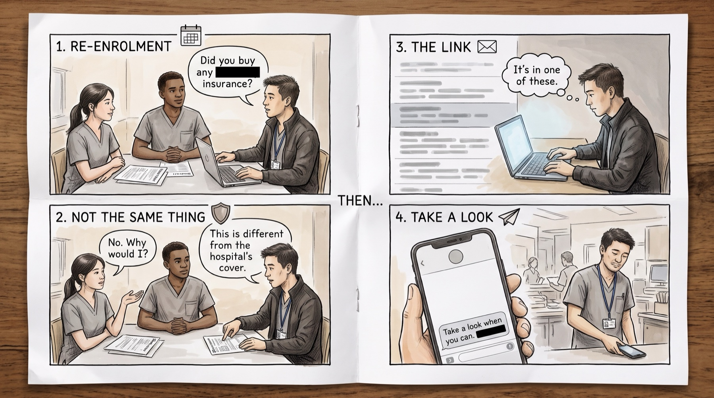
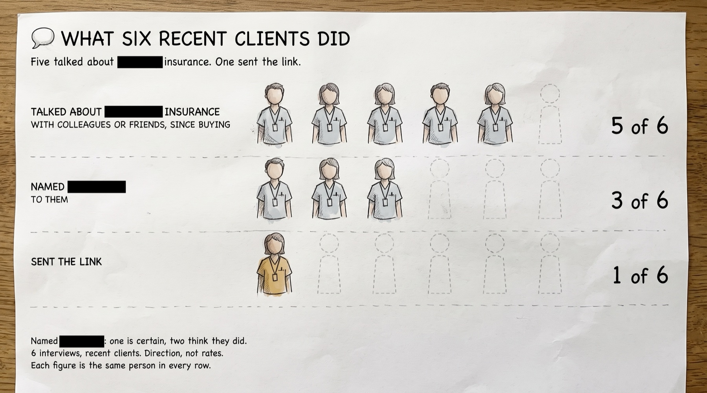

# interview-to-image

[](LICENSE)

Research findings may land better as a picture than as a paragraph. This skill turns interview transcripts, summaries or profiles into prompts for an image generator, by default a hand-drawn research comic, so you can present findings (or any other work) in a more engaging, relatable way than a report alone. Use the images instead of a report, or alongside one to make the findings easier to remember. Free, MIT licensed.

A "profile" here means a short write-up of one interview: a summary of the key points with a few quotes. A summary is the same idea, shorter and without quotes.

The skill interviews you first (source, privacy, image type, audience, where the image will be used), pulls candidate moments out of your material, writes one prompt per page, and gives you a QA checklist for the images that come back.

**Latest release:** [v1.0.0](https://github.com/renebastijans/interview-to-image/releases/latest) (see all [releases](https://github.com/renebastijans/interview-to-image/releases)).

## Example output

These two pages come from a real but small interview study, anonymised: the study looked at how customers of a financial-services provider talk about the service with colleagues and friends after buying, and whether they pass on a referral link. Names, the organisation and the product were removed or blacked out, and the interviews themselves are not included. Both pages were rendered in Gemini (Nano Banana, "Pro" mode, paid plan) and then edited in the same chat.



*Story page: one interview, four panels. The black bars are part of the design (a "redaction bar" device that keeps names out of the picture).*



*Data page: a chart restyled in the same hand-drawn look. Counts are "n of N", "direction, not rates".*

The prompts for these two pages are not included. `examples/` holds a fully invented sample (extract and prompt) that shows the format.

## What it does not do

- The skill itself does **not generate images** and does not call any image API: it writes the prompts. In the manual path you paste them into an image generator yourself. In a coding product, the assistant can also run the prompts for you by driving a browser (see path B), or you can paste them yourself.
- It does not replace a human read. Image models misspell text, so every image needs checking word by word.
- It is not a privacy tool. See the warning below.

## Privacy: read this first

Your transcript or profile goes to a third-party service twice: to the LLM that writes the prompt, and (as a prompt) to the image generator. Before you start:

- Check you have **consent** for this use and that your organisation's data rules allow it.
- **Public use** (portfolio, blog, conference, shared deck): anonymise by default: names, employer, role, location, products, amounts. When unsure, paraphrase instead of quoting.
- **Internal or client use**: if consent and your data rules allow it, you can keep real names, quotes and details. The skill asks which of the two applies and sets the anonymisation level from your answer.
- Either way, the generator's output can be shared further than you intend, so decide what is safe before you paste.

## Tested on

- **Paid plan:** Gemini's image creator (Nano Banana) with the "Pro" mode selected, which the picker labels "Detailed research, 3.1 Pro" (the other modes offered were "Everyday help" and "Complex problems").
- **Free tier:** Gemini's image creator (Nano Banana), image mode "Auto"; the "Deeper analysis" option was locked.
- **Both tiers needed iteration.** The paid plan needed a few rounds of edits too. A test of one page prompt on the free tier also produced a usable page, but with more errors and more iteration: a dropped word in a quoted line, an extra redaction bar, a blank bubble that could read as a reply, and a laptop logo. Same-chat edits fixed these, with side effects (see tips). That is one image from one run, so do not treat the free tier as equivalent.
- **Not tested:** any other image generator, other image types (single illustrations, sketchnotes), very long transcripts end to end.
- Tested on a handful of pages: story pages built from single interview profiles and one data page restyled from a chart. Treat the prompts as a strong starting point, not a guarantee.

## Two ways to use it

### A. Manual copy and paste (any chat assistant, no coding tool)

1. Open [`manual/manual-kit.md`](manual/manual-kit.md).
2. Paste the intake prompt into your chat assistant and answer its questions.
3. Paste the moments prompt followed by your (anonymised) source. Pick a moment.
4. Paste the three reference files named in the kit, then the page-writing prompt.
5. Copy the section between `PROMPT START` and `PROMPT END` into your image generator.

### B. Claude Code or another LLM coding product

Copy the skill folder `interview-to-image/` into your skills directory. For Claude Code:

```bash
mkdir -p ~/.claude/skills
cp -r interview-to-image ~/.claude/skills/
```

Then ask: "Turn this interview into a comic" and point it at your file. The skill runs the intake, writes `prompt-page-N-<slug>.md` files, and, if your product can read images, checks the renders you send back. Other products that read `SKILL.md`-style instructions can use the same folder; otherwise paste `SKILL.md` and the `references/` files in as instructions.

**Letting the assistant render the images.** If your product can drive a browser, the assistant can paste each prompt into Gemini for you and read the result for QA. This is how the paid-plan test pages were produced: the user logged in to Gemini themselves and gave permission for the browser session, so nothing was pasted by hand. Log in yourself, never hand the assistant your password, and keep the privacy points above in mind: the prompt still goes to Google.

The skill does not call an image API in either path.

## Can I use a raw transcript?

Yes, but not as the image prompt. The generator never needs the transcript. It needs a prompt of roughly 1,000 to 1,500 words describing one scene. The LLM reads the transcript and compresses it into what a profile would give you: a short list of candidate moments with exact quotes, who said them, whether the interviewer prompted them, and a timestamp. Then you pick a moment and it writes the prompt.

- A **profile or summary is faster and safer**: already compressed and easier to anonymise. A transcript needs the extraction step first, which the skill includes.
- For **long transcripts**, extract topics first, then moments per topic. Do not paste 40 minutes and ask for a comic.
- **Speech-to-text errors are real** (names spelled several ways, misheard words). The extraction step fixes them; check quotes against the transcript.
- A profile is an interpretation, so check data pages against the transcripts where you can.
- **Prompted versus unprompted** lines are kept apart: what the interviewer raised first is not the participant's behaviour.
- Keep **quoted lines short**: image models spell short lines far better than long ones.

## After the prompt: render and check

1. Open your image generator (mainly tested: Gemini image creator, Nano Banana, "Pro" mode, paid; one free-tier run in "Auto" mode). Start a **new chat for each page**.
2. Paste the prompt. **Paste only the section between `PROMPT START` and `PROMPT END`**, not the notes or frontmatter. If the prompt says to attach an image, attach it first.
3. Wait for the image, then **zoom in and read every word** against the prompt, using [the QA checklist](interview-to-image/references/qa-checklist.md).
4. If something is wrong, **do not rerun the whole prompt**. Reply in the same chat with an edit instruction (template below).
5. Save the image at full size with the generator's download button and name it for the page.
6. Place it in your deck, page or document, **add alt text**, and note any blemishes you accepted.

Edit instruction template:

> Regenerate this exact image and change nothing else, with one correction: in panel N the text currently reads "…". It must read exactly "…". Keep every face, seat, layout, bubble and line of lettering exactly as it is.

## Iteration tips

- **Fix one thing at a time, in the same chat.** The edit template above held on the first try in testing. A full rerun redraws the faces.
- **Use the lettering block** in every prompt (only the listed lettering, no title, one bubble per speaker, screens show grey bars only, no logos). Without it the generator added an extra title, repeated and garbled a line, drew a QR-like pattern on a phone and put a logo on a laptop.
- **Fix seats and looks** when two panels are one conversation: left, middle, right; distinct hair, skin tone and clothing; "panel 2 is the next moment of panel 1"; "the bubble tail points to the speaker".
- **Edits trade off.** Say what must stay in frame. Fix an empty area (for example a blank phone screen) by cropping, not by repositioning one element; in testing, repositioning made it worse and a crop pushed a character out of frame.
- **Edits can leak into other panels.** Name the panel to change, then recheck every panel afterwards; one edit changed a character's clothing in a different panel.
- **Layout may drift.** A longer lettering block turned four panels in a row into a 2x2 grid. Say "four panels in one row, left to right" if it matters.
- **Charts:** build the exact chart yourself (script or SVG), attach it, and say "restyle, not redesign". In testing, figure positions, counts and labels came back accurately.
- **Check every word.** Dropped words are the most common lettering fault ("when can." for "when you can.").
- **Treat the first render as a draft.** Every image needs a human read.
- **Never let a data page imply more than it knows:** counts as "n of N", no percentages for small samples, "direction, not rates", no funnel or arrows between rows.

## Known limits

- Text inside images is fragile: expect to check and fix lettering.
- Layout can drift from what you asked for.
- One image model family tested: mainly a paid plan, one run on the free tier.
- One interview is not a pattern; the skill flags this and writes one story page only.

## What is in this repo

| Path | What |
|---|---|
| `interview-to-image/` | The skill folder (`SKILL.md` plus `references/`) for Claude Code and similar tools |
| `manual/manual-kit.md` | Copy-and-paste prompts for any chat assistant |
| `examples/` | A fully invented interview extract and one resulting page prompt, plus two anonymised example images in `examples/images/` |
| `CONTRIBUTING.md` | How to contribute, and the no-real-data rule |
| `CHANGELOG.md` | What changed in each release |
| `CODE_OF_CONDUCT.md`, `SECURITY.md` | Community conduct and how to report problems privately |
| `LICENSE` | MIT |

## Feedback

Open an issue on this repo. Pull requests welcome, especially notes from other image generators. See [CONTRIBUTING.md](CONTRIBUTING.md), including the rule against posting real interview data.

## Acknowledgements

- Everyone who sends generator feedback or fixes: see the [contributors graph](https://github.com/renebastijans/interview-to-image/graphs/contributors).
- The research participants whose interviews, in anonymised and invented form, shaped the tests and examples.
- Written with help from Claude (Anthropic), and tested with Google's Gemini and Nano Banana.
- The [Keep a Changelog](https://keepachangelog.com/) and [Contributor Covenant](https://www.contributor-covenant.org/) projects, which shaped the changelog and conduct files.

## Author

René Bastijans, [github.com/renebastijans](https://github.com/renebastijans)
